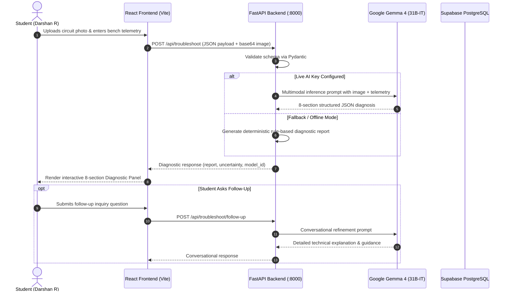

# LabSense AI — Multimodal AI-Powered Electronics Laboratory Learning Platform

[](https://github.com/HackToBerFest-VVCE/t1c1-hack-hive)
[](https://github.com/HackToBerFest-VVCE/t1c1-hack-hive)
[](https://react.dev/)
[](https://fastapi.tiangolo.com/)
[](https://ai.google.dev/)
[](https://supabase.com/)
[](src/App.css)

**LabSense AI** is an intelligent multimodal electronics laboratory learning and institutional management platform. It empowers engineering students to investigate physical breadboard circuit faults, analyze bench telemetry, and master systematic troubleshooting through multimodal reasoning powered by **Google Gemma 4** (`gemma-4-31b-it`).

Developed for the **"Best Use of Gemma 4"** track at Hacktoberfest (VVCE Mysuru), the platform unifies role-based laboratory portals, multi-tenant institutional workspace isolation with unique college codes, interactive physics simulations, curriculum authoring benches, and evidence-based 8-section diagnostic reports.

---

## 1. Problem Statement

Undergraduate engineering students frequently encounter severe bottlenecks when troubleshooting physical circuits in hardware laboratories:

1. **Difficult Fault Localization:** Misplaced jumper wires, inverted polarity components (diodes, LEDs, electrolytic capacitors), and IC pin miscounts are difficult to detect from static printed manuals.
2. **Ambiguous Multimeter Telemetry:** Students often struggle to distinguish between expected component voltage drops, floating inputs, and fault-induced anomalies.
3. **Hardware Burnout & Safety Risks:** Overcurrent loops and omitted current-limiting resistors cause component damage, instrument fuse blowouts, and bench downtime.
4. **Supervision Bottlenecks:** A single laboratory instructor must supervise 30–60 students simultaneously, causing long queues for verifying steps, debugging circuits, and assessing progress.
5. **Institutional Fragmentation:** Academic institutions lack unified digital infrastructure to track hardware experiments, issue standardized lab codes, manage cohort rosters, and author curriculum modules.

---

## 2. Key Features & User Roles

LabSense AI features a hierarchical role-based access model with dynamic profile rendering and context-driven portal routing:

```
┌────────────────────────────────────────────────────────────────────────┐
│                         LabSense AI Platform                           │
└────────────────────────────────────────────────────────────────────────┘
          │                     │                     │
          ▼                     ▼                     ▼
   [Student Portal]   [Instructor Portal]    [Institution Admin]
   • Breadboard AI    • Lab Designer         • Campus Metrics
   • Telemetry Check  • Question Inbox       • Code Distribution
   • 5 Simulations    • Test Authoring       • Faculty/Student Roster
   • Assessments      • Cohort Analytics     • Lab Allocations
          │                     │                     │
          └─────────────────────┼─────────────────────┘
                                ▼
                   [Super Admin Governance]
                   • Multi-Campus Management
                   • AI Model Telemetry
                   • System Audit Logs
```

### 1. Student Learning Portal (`Darshan R` • USN: `4VV21EC042`)
- **Multimodal Circuit Troubleshooter:** Staging of breadboard photographs, multimeter measurement input ($V_{supply}$, $V_{measured}$, $I$), symptom descriptions, and real-time generation of 8-section diagnostic reports.
- **Interactive Multi-Turn Follow-Up:** Students can ask follow-up questions to clarify diagnostic steps directly with Gemma 4.
- **Curriculum Catalog:** Built-in repository of electronics experiments with difficulty tags, component lists, pinouts, and procedures.
- **Physics Simulations:** Five interactive client-side simulation engines with real-time sliders and electrical safety warnings.
- **Practical Assessments:** Multiple-choice evaluations with automated scoring and answer rationale.
- **Inquiry Tickets:** Direct messaging to lab instructors with bench telemetry context.
- **Student Scope Banner:** Displays student name, USN, semester, enrolled courses, and college affiliation.

### 2. Instructor & Faculty Portal (`Dr. Chethan M S` • Staff ID: `VVCE-FAC-ECE-108`)
- **Experiment Designer:** Authoring bench to compose laboratory modules, define component lists, specify expected readings, and attach safety rules.
- **Student Question Inbox:** Inquiry triage system displaying student breadboard telemetry, question history, and Gemma AI-assisted reply drafting.
- **Assessment Authoring Tool:** Test creator with AI-assisted question drafting, option management, and answer key generation.
- **Cohort Analytics:** Real-time completion rates, average diagnostic scores, and student sign-offs.
- **Faculty Scope Banner:** Displays faculty name, staff ID, department, and assigned courses.

### 3. Institution Admin Dashboard (`Prof. Chinmayi D A` • Principal)
- **Campus Workspace Overview:** Department metrics, enrolled student count, active faculty, and lab utilization.
- **Institution Code Distribution:** Active code management (`LSAI-VVCE-A7K2`), one-click copying, and regeneration controls.
- **Department & Lab Management:** Laboratory facility configuration, equipment allocation, and bench limits.
- **Faculty & Student Rosters:** Directory of enrolled learners and laboratory coordinators with status badges.
- **Administrative Logs:** Audit trail of user registrations, code redemptions, and workspace events.

### 4. Platform Super Admin Governance (`Harshith T S` • Platform Super Admin)
- **Global Multi-Tenant Metrics:** Platform-wide oversight (colleges, total students, instructors, and diagnostics performed).
- **Institution Directory & Review:** Workflow to review, approve, or reject new college registration requests.
- **User Governance:** Cross-institutional directory with status toggling (active / suspended).
- **Inference & Platform Health:** Model identifier monitoring (`gemma-4-31b-it`), response latency, and security audit records.

---

## 3. How Gemma 4 Powers LabSense AI

The intelligence layer uses Google's **Gemma 4** (`gemma-4-31b-it`) via the Google GenAI / Gemini API to deliver multimodal reasoning for electronics laboratories:

```
[Physical Breadboard] ──> [Photo Ingestion] ──> [Multimeter Telemetry]
                                                        │
                                                        ▼
[Pydantic Validation] ──> [Gemma 4 Multimodal Analysis] ──> [8-Section Diagnostic Report]
                                                                        │
                                      ┌─────────────────────────────────┴─────────────────────────────────┐
                                      ▼                                                                   ▼
                          1. Layout Observations                                              5. Verification Tests
                          2. Potential Faults & Likelihood                                    6. Expected Observations
                          3. Supporting Telemetry Evidence                                    7. Corrective Wiring Steps
                          4. Ambiguities / Missing Data                                       8. Safety Precautions
```

### Multimodal Reasoning Pipeline

1. **Physical Layout Understanding:**
   - Ingests breadboard photographs (JPEG, PNG, WebP up to 10 MB).
   - Converts uploaded base64 images into Pillow (`PIL.Image`) objects and attaches them directly to the multimodal prompt.
   - Inspects power rails, polarity markers on electrolytic capacitors/LEDs/diodes, and resistor color-code bands.

2. **Telemetry Validation (Expected vs. Actual):**
   - Correlates user-supplied multimeter readings against calculated theoretical values.
   - Detects short circuits, open loops, floating inputs, and excessive resistor heating.

3. **Structured 8-Section JSON Diagnostic Output:**
   Gemma 4 is instructed with a strict system prompt to format diagnosis into 8 structured sections:
   - `circuit_observations`: Physical layout details and component placements identified.
   - `potential_faults`: Array of ranked fault hypotheses (`fault`, `likelihood`: High / Medium / Low, `evidence`).
   - `telemetry_evidence`: Correlation between expected nominal values and reported bench measurements.
   - `ambiguities_missing_data`: Missing multimeter measurements or ambiguous wiring points.
   - `verification_tests`: Step-by-step probe instructions (`step_number`, `test_description`, `multimeter_mode`, `expected_nominal`).
   - `expected_nominal_readings`: Theoretical target voltages and currents for a working circuit.
   - `corrective_steps`: Safe, actionable wiring modifications.
   - `safety_precautions`: Critical warnings (e.g., de-energizing bench supply before moving probe leads).

4. **Multi-Turn Interactive Follow-Up:**
   Students can ask clarifying questions about specific verification steps or observations. The backend retains diagnostic context and returns conversational, educational responses.

5. **Deterministic Fallback Engine:**
   If API credentials are unavailable or the live model rate limit is exceeded, the backend seamlessly falls back to a deterministic rule-based calculation engine (`simulation_engine.py`) so testing is never interrupted.

---

## 4. Technology Stack

| Layer | Technologies | Role in Platform |
| :--- | :--- | :--- |
| **Frontend UI** | React 18, Vite 6, Lucide React | Single-page application with 4 distinct role dashboards |
| **Styling** | Custom CSS3 (`src/App.css`) | Dark navy design system (`#070d1e`, `#0b1329`, `#101c3d`) with transparent cyan navigation |
| **State & Session** | React Context API, `localStorage` | Client-side session management with multi-role evaluation switcher |
| **Backend API** | FastAPI, Uvicorn, Python 3.10+ | Asynchronous REST API serving intelligence and simulation routes |
| **Data Validation** | Pydantic v2 | Strict request/response schema validation and type coercion |
| **AI Inference** | Google GenAI SDK, Gemma 4 (`gemma-4-31b-it`) | Multimodal vision-language reasoning, question drafting, and tutoring |
| **Database & Auth** | Supabase, PostgreSQL | Multi-tenant schema, Row-Level Security (RLS), and user authentication |

---

## 5. System Architecture & Request Flow



---

## 6. Project Folder Structure

```
LabSense AI/
├── backend/                               # FastAPI Intelligence Layer
│   ├── models/
│   │   └── schemas.py                     # Pydantic schemas for circuits & simulations
│   ├── routers/
│   │   ├── assessments.py                 # Quiz drafting and automated grading
│   │   ├── auth.py                        # Instructor authorization code verification
│   │   ├── experiments.py                 # Experiment catalog & inquiry endpoints
│   │   ├── questions.py                   # Question inbox & AI reply drafting
│   │   ├── simulations.py                 # Simulation calculation & AI tutor
│   │   └── troubleshoot.py                # Gemma 4 multimodal circuit troubleshooting
│   ├── services/
│   │   ├── gemma_service.py               # Gemma 4 integration with multimodal prompt construction
│   │   └── simulation_engine.py           # 5 deterministic physics simulation engines
│   ├── tests/
│   │   ├── run_tests.py                   # Automated test runner (13 test cases)
│   │   └── test_api.py                    # Comprehensive API endpoint verification tests
│   ├── config.py                          # Environment settings & CORS policies
│   └── main.py                            # FastAPI application entrypoint & middleware
├── public/
│   ├── favicon.svg                        # Platform circuit icon
│   └── icons.svg
├── src/                                   # React Frontend
│   ├── components/
│   │   ├── admin/
│   │   │   └── InstitutionAdminDashboard.jsx   # College admin workspace & roster console
│   │   ├── instructor/
│   │   │   ├── InstructorExperiments.jsx       # Experiment authoring workbench
│   │   │   ├── InstructorPortal.jsx            # Faculty navigation layout & banner
│   │   │   ├── InstructorProgress.jsx          # Cohort performance & lab sign-offs
│   │   │   ├── InstructorQuestions.jsx         # Question triage with AI reply co-pilot
│   │   │   └── InstructorTests.jsx             # Assessment test authoring tool
│   │   ├── student/
│   │   │   ├── StudentAssessments.jsx          # Multiple-choice lab quizzes
│   │   │   ├── StudentExperiments.jsx          # Experiment catalog with AI inquiry
│   │   │   ├── StudentPortal.jsx               # Student 6-tab navigation layout
│   │   │   ├── StudentProgress.jsx             # Completion records & grade tracking
│   │   │   ├── StudentQuestions.jsx            # Inquiry ticket authoring form
│   │   │   ├── StudentSimulations.jsx          # 5 interactive physics simulation engines
│   │   │   └── StudentTroubleshoot.jsx         # Breadboard diagnosis workbench
│   │   ├── superadmin/
│   │   │   └── SuperAdminDashboard.jsx         # Multi-campus governance dashboard
│   │   ├── AuthModal.jsx                  # Multi-role login, signup & college code verification
│   │   ├── DiagnosisPanel.jsx             # 8-section diagnostic results panel
│   │   ├── ErrorBoundary.jsx              # React crash catcher & fallback card
│   │   ├── ExperimentForm.jsx             # Multimeter telemetry input form
│   │   ├── Footer.jsx                     # Hardware safety guidelines & footer
│   │   ├── Header.jsx                     # Navy header with cyan nav & user profile
│   │   ├── Hero.jsx                       # Platform introduction & CTA
│   │   ├── HowGemmaWorks.jsx              # Multimodal architecture explanation modal
│   │   ├── HowItWorks.jsx                 # 3-step workflow guide
│   │   └── ImageUpload.jsx                # Drag-and-drop circuit photo ingestion
│   ├── context/
│   │   └── AuthContext.jsx                # Multi-role auth provider & session management
│   ├── lib/
│   │   ├── api.js                         # API client with fallback report generation
│   │   └── supabase.js                    # Supabase client configuration
│   ├── App.css                            # Custom design system styling
│   ├── App.jsx                            # Root view router
│   └── main.jsx                           # React application entrypoint
├── supabase/                              # Database Migrations & Seeds
│   ├── migrations/
│   │   ├── 001_initial_schema.sql         # Core database schema with strict RLS
│   │   └── 002_institution_hierarchy_and_rbac.sql # Multi-tenant hierarchy & audit logs
│   ├── seed.cjs                           # Automated database audit & verification tool
│   ├── seed.sql                           # Initial benchmark experiment seed data
│   └── seed_demo_data.sql                 # Repeatable demo data seed script
├── .env.example                           # Sanitized environment template
├── .gitignore                             # Git exclusion rules
├── index.html                             # HTML5 document entry
├── package.json                           # Frontend dependencies & scripts
├── vite.config.js                         # Vite 6 configuration
└── README.md                              # Project documentation
```

---

## 7. Installation and Local Setup

### Prerequisites
- **Node.js:** v18.0.0 or higher (Tested on Node.js v22.16.0)
- **npm:** v9.0.0 or higher (Tested on npm v10.9.2)
- **Python:** v3.10 or higher (Tested on Python 3.13.3)
- **Modern Web Browser:** Chrome, Edge, Firefox, or Safari

---

### Step-by-Step Instructions

#### 1. Clone the Repository
```bash
git clone https://github.com/HackToBerFest-VVCE/t1c1-hack-hive.git
cd t1c1-hack-hive
```

#### 2. Configure Environment Variables
Copy the template `.env.example` to `.env`:
```bash
cp .env.example .env
```
Open `.env` and fill in your credentials (see [Section 8](#8-environment-variables) for variable details).

#### 3. Setup and Run the Backend (FastAPI)
```bash
# 1. Install required Python packages
pip install fastapi uvicorn pydantic python-dotenv google-genai pillow

# 2. Run backend verification tests
python -m unittest backend.tests.test_api

# 3. Start the FastAPI server
python -m uvicorn backend.main:app --host 127.0.0.1 --port 8000 --reload
```
The backend API will start at:
```
http://127.0.0.1:8000
```
Interactive Swagger API documentation will be available at:
```
http://127.0.0.1:8000/docs
```

#### 4. Setup and Run the Frontend (React + Vite)
In a separate terminal window:
```bash
# 1. Install npm dependencies
npm install

# 2. Start the Vite development server
npm run dev
```
The frontend UI will start at:
```
http://localhost:5173
```

---

## 8. Environment Variables

The repository provides [`.env.example`](.env.example) with placeholder values. **Never commit real API keys or secrets to version control.**

```env
# ==============================================================================
# CATEGORY 1: FRONTEND CLIENT CONFIGURATION (Vite Client-Side)
# ==============================================================================
VITE_API_BASE_URL=http://localhost:8000
VITE_SUPABASE_URL=https://your-project-ref.supabase.co
VITE_SUPABASE_ANON_KEY=eyJhbGciOiJIUzI1NiIsInR5cCI6IkpXVCJ9.your-anon-key-placeholder

# ==============================================================================
# CATEGORY 2: GEMMA 4 INFERENCE (FastAPI Server-Side Only)
# Obtain from: https://aistudio.google.com/
# ==============================================================================
GEMINI_API_KEY=your_gemini_api_key_placeholder
GEMMA_MODEL_ID=gemma-4-31b-it
GEMMA_FALLBACK_MODEL_ID=gemma-4-26b-a4b-it

# ==============================================================================
# CATEGORY 3: BACKEND SERVER RUNTIME & SECURITY
# ==============================================================================
APP_ENV=development
PORT=8000
HOST=127.0.0.1
INSTRUCTOR_INVITE_CODE=LABSENSE-INST-2026

# ==============================================================================
# CATEGORY 4: SUPABASE SERVER-SIDE (Optional)
# ==============================================================================
SUPABASE_URL=https://your-project-ref.supabase.co
SUPABASE_ANON_KEY=your_anon_key_placeholder
SUPABASE_SERVICE_ROLE_KEY=your_service_role_key_placeholder
```

---

## 9. Interactive API Documentation (`/docs`)

FastAPI automatically generates an interactive Swagger UI documentation interface:

1. Open your browser and navigate to:
   ```
   http://127.0.0.1:8000/docs
   ```
2. You can inspect request schemas, parameter types, and execute live API calls:
   - `GET /api/health`: Verify service status and model configuration.
   - `POST /api/troubleshoot`: Test circuit diagnosis with sample measurements and image payloads.
   - `POST /api/troubleshoot/follow-up`: Test multi-turn conversational troubleshooting.
   - `POST /api/simulations/calculate`: Calculate electrical operating points for any of the 5 simulation types.
   - `GET /api/experiments`: View the benchmark curriculum library.
   - `POST /api/auth/verify-instructor-code`: Verify instructor elevation codes.

---

## 10. Database Architecture & Authentication

### Database Schema (Supabase PostgreSQL)
The database structure is maintained across two migration files in `supabase/migrations/`:
- **`001_initial_schema.sql`**: Core entities (`profiles`, `instructor_invites`, `experiments`, `tests`, `test_questions`, `student_answers`) with strict Row-Level Security (RLS).
- **`002_institution_hierarchy_and_rbac.sql`**: Multi-tenant institutional hierarchy (`institutions`), 4-role RBAC (`student`, `instructor`, `institution_admin`, `platform_super_admin`), registration approval workflows, and administrative audit logging (`audit_logs`).

### College Code Validation
Students register by supplying an approved college code (e.g., `LSAI-VVCE-A7K2`). The registration flow verifies that:
1. The college code exists in `public.institutions`.
2. The institution status is `approved` and `is_active = true`.
3. The student's profile is automatically linked to the institution's UUID via the `handle_new_user()` trigger.

### Seeding Demo Data
To populate the database with benchmark colleges, experiments, tests, and audit logs:
- **Option 1 (Supabase Dashboard SQL Editor):** Open your Supabase SQL Editor and execute [`supabase/seed_demo_data.sql`](supabase/seed_demo_data.sql).
- **Option 2 (Automated Node Script):** Supply `SUPABASE_SERVICE_ROLE_KEY` in `.env` and run:
  ```bash
  node supabase/seed.cjs
  ```

---

## 11. Security Notes & Troubleshooting

### Security Safeguards
- **Zero Committed Secrets:** The repository `.gitignore` strictly excludes `.env`, credential files, and build directories.
- **Service Role Key Isolation:** Service-role keys are never prefixed with `VITE_` and are never exposed to browser client bundles.
- **Row-Level Security (RLS):** All Supabase tables enforce RLS policies so students can only view published materials and their own submissions.
- **Protected Instructor Promotion:** Instructor accounts cannot be self-assigned; they require a valid authorization code verified by the backend (`INSTRUCTOR_INVITE_CODE`).

### Common Setup Troubleshooting

| Issue / Error | Cause | Resolution |
| :--- | :--- | :--- |
| **`Email not confirmed` on login** | Supabase has "Confirm email" enabled. | Verify your email using the link sent by Supabase, or in your Supabase Dashboard toggle **Authentication -> Providers -> Email -> "Confirm email"** to **OFF** for local testing. |
| **`email rate limit exceeded`** | Default Supabase SMTP allows only 3-4 signup emails/hour. | Disable "Confirm email" in the Supabase Dashboard, or configure a custom SMTP provider (e.g., SendGrid, Resend). |
| **Backend connection refused (`:8000`)** | FastAPI backend server is not running. | Start the backend using: `python -m uvicorn backend.main:app --port 8000`. |
| **CORS errors in browser console** | Origin mismatch between frontend and backend. | Verify that `http://localhost:5173` is listed in `CORS_ORIGINS` in `backend/config.py`. |
| **`Invalid or unapproved institution code`** | Code is mistyped or institution is not marked `approved`. | Use the pre-seeded approved college code: `LSAI-VVCE-A7K2`. |

---

## 12. Current Limitations & Future Roadmap

- **Video Stream Inspection:** Real-time breadboard video feed diagnosis using WebRTC and Gemma Live API stream reasoning.
- **Automated Rubric Grading:** Instructor grading engine using Gemma 4 to grade open-ended procedural answers against laboratory rubrics.
- **Full SPICE Simulation:** Server-side integration with Ngspice for complete transient and frequency-domain circuit analysis.
- **Hardware Integration:** Direct telemetry streaming from USB oscilloscopes and smart multimeters via WebUSB.

---

## 13. Repository & Event Information

- **Challenge Track:** Hacktoberfest VVCE Mysuru — Best Use of Gemma 4
- **Repository URL:** [`https://github.com/HackToBerFest-VVCE/t1c1-hack-hive`](https://github.com/HackToBerFest-VVCE/t1c1-hack-hive)
- **Branch:** `main`
- **License:** MIT License
- **Developed by Team:**
  - **Harshith T S** — Platform Super Administrator & System Architect
  - **Prof. Chinmayi D A** — Institutional Administrator (VVCE)
  - **Dr. Chethan M S** — Faculty Instructor & Lab Coordinator (Dept of ECE)
  - **Darshan R** — Student Learner & Hardware Diagnostic Evaluator (USN: `4VV21EC042`)
